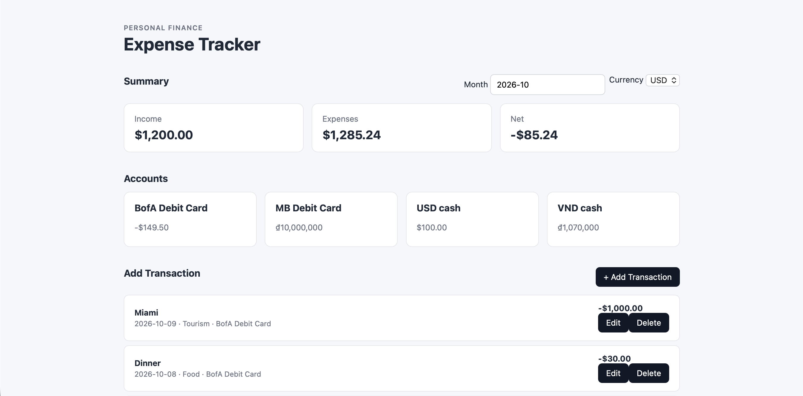

# Expense Tracker

A full-stack personal finance tracker built with **Node.js, Express, and SQLite**.

It started as a simple income/expense book and grew into a small net-worth
tracker: it aggregates total assets in VND across every account and gold
holding, tracks savings goals, and visualizes spending trends with charts.

The project focuses on relational database design, transactional consistency,
a layered REST API, automated testing, a lightweight vanilla-JS frontend, and
continuous deployment to a small cloud VM.

## Features

- Create, view, update, and delete income and expense transactions
- Track balances across multiple accounts
- Support accounts with different currencies
- Organize transactions by category
- Transfer money between accounts, including cross-currency transfers
- Create pending transfers and complete them later
- View monthly income, expenses, and net totals
- Filter dashboard summaries by month, currency, and account
- **Total assets** valued in VND across all accounts plus gold holdings
- Account types: **spending, savings, gold**
- **Gold holdings** measured in `chi` / `luong`, priced from the live SJC rate
  with a manual-entry fallback
- **Savings goals** with contributions and a progress bar
- Dashboard charts: last 6 months spending bar chart and per-category donut
- JSON backup export/import of the whole book
- Manage accounts, categories, and currencies through the app
- Start with an empty book and add your own data
- Store money as integers in the smallest unit of each currency
- Archive accounts, categories, and currencies while preserving history
- Maintain account balances with atomic database operations
- Validate business rules at the service layer
- Protect data integrity with SQLite constraints
- Automated service and REST API tests

## Preview



## Tech Stack

### Backend

- Node.js
- Express
- SQLite (`sqlite3`)

### Frontend

- HTML, CSS
- Vanilla JavaScript (ES modules)
- Fetch API
- Chart.js (served locally — see below)

### Testing

- Jest
- Supertest

### Operations

- GitHub Actions (CI + CD)
- pm2 (process manager)
- nginx (reverse proxy + basic auth)
- Azure VM (Ubuntu 24.04)

## Architecture

The application uses a layered backend architecture:

```text
Browser
  ↓
REST API
  ↓
Routes          (HTTP only: parse request, call service, send response)
  ↓
Services        (business logic + SQL)
  ↓
Database Layer  (Promise wrappers over sqlite3)
  ↓
SQLite
```

- **Routes** validate the HTTP contract and delegate to services. No SQL here.
- **Services** hold business logic and talk to SQLite through the database layer.
- **Database Layer** exposes `run()`, `get()`, `all()`, `exec()`, and
  `withTransaction()` so services can use async/await.

See [`docs/architecture.md`](docs/architecture.md) for details.

## Database Design

Entities:

- Currency
- Category
- Account (`type`: spending / savings / gold)
- Transaction
- Transfer
- Gold holding
- Savings goal
- Savings contribution
- Exchange rate
- App settings

Relationships:

```text
Currency
  ├── Account
  │     ├── Transaction
  │     ├── Transfer
  │     └── Gold holding
  └── Savings goal ── Savings contribution

Category ── Transaction
Currency ── Exchange rate (one rate per currency)
```

See [`docs/database-design.md`](docs/database-design.md) for details.

### Money, Gold, and Exchange Rates

**Money** is stored as integers in the smallest unit of each currency.

- `currencies.decimal_places` records a currency's number of decimal places.
- `$10.50` (USD, 2 decimals) is stored as `1050` cents.
- `₫70,000` (VND, 0 decimals) is stored as `70000` dong.

JavaScript numbers are IEEE-754 doubles, so using them for money risks rounding
drift, and SQLite's `NUMERIC` is only a type affinity, not an exact decimal type.
Integers avoid both problems. The API accepts and returns money only as integers;
the browser converts between minor units and display format.

**Gold quantity** is stored as an integer in thousandths of the unit, so it stays
exact: `1.5 luong` is stored as `1500`, `0.5 chi` as `500`. One `luong` equals
10 `chi`. Value in VND = `quantity / 1000 * price per unit`.

**Exchange rates** are ratios, not money, so they are stored as integers in
**micro units** (`rate * 1_000_000`). This convention is shared by
`transfers.exchange_rate` and `exchange_rates.rate_to_vnd`.

See [`docs/database-design.md`](docs/database-design.md) for details.

## Data Integrity

The database uses primary keys, foreign keys, `NOT NULL`, `UNIQUE`, and `CHECK`
constraints, plus indexes on common query paths.

The service layer performs business validation to produce meaningful
application errors. Database constraints remain the final integrity boundary.

Two values are intentionally immutable once data exists, because existing
balances are expressed in them: a currency's `decimal_places`, and an account's
currency once it has history.

## Atomic Balance Updates

Account balances are stored in the database rather than recalculated from the
full transaction history, so any operation that changes both financial records
and balances must be atomic.

Such operations run inside a single `withTransaction()` block using
`BEGIN IMMEDIATE`, and either `COMMIT` or `ROLLBACK`. This covers creating,
updating, and deleting transactions, completing transfers, and the JSON restore.

## API Reference

The API has no `/api` prefix; routes are mounted at the root.

### Transactions

| Method | Endpoint | Description |
|---|---|---|
| `GET` | `/transactions` | List transactions (supports filters) |
| `GET` | `/transactions/:id` | Get one transaction |
| `POST` | `/transactions` | Create a transaction |
| `PUT` | `/transactions/:id` | Update a transaction |
| `DELETE` | `/transactions/:id` | Delete a transaction |

### Accounts

| Method | Endpoint | Description |
|---|---|---|
| `GET` | `/accounts` | List accounts and balances |
| `GET` | `/accounts?active=1` | List active accounts only |
| `POST` | `/accounts` | Create an account (`name`, `currencyId`, `initialBalance`, `type`) |
| `PUT` | `/accounts/:id` | Update name, currency, type, or active status |

An account's currency cannot change once it has transactions or transfers.

### Categories

| Method | Endpoint | Description |
|---|---|---|
| `GET` | `/categories` | List active categories |
| `GET` | `/categories?all=1` | List categories including archived |
| `POST` | `/categories` | Create a category (`name`) |
| `PUT` | `/categories/:id` | Update name or active status |

### Currencies

| Method | Endpoint | Description |
|---|---|---|
| `GET` | `/currencies` | List currencies |
| `GET` | `/currencies?active=1` | List active currencies only |
| `GET` | `/currencies?all=1` | List currencies including archived |
| `POST` | `/currencies` | Create a currency (`code`, `name`, `symbol`, `decimalPlaces`) |
| `PUT` | `/currencies/:id` | Update name, symbol, or active status |

A currency's code and `decimalPlaces` are fixed after creation.

### Transfers

| Method | Endpoint | Description |
|---|---|---|
| `GET` | `/transfers` | List transfers |
| `GET` | `/transfers/:id` | Get one transfer |
| `POST` | `/transfers` | Create a transfer |
| `PATCH` | `/transfers/:id` | Complete a pending transfer |

### Dashboard

| Method | Endpoint | Description |
|---|---|---|
| `GET` | `/dashboard` | Income, expense, net, per-category, and monthly trend |

Query parameters: `start`, `end`, `currency`, optional `accountId`, and
`months` (number of months for the trend, default 6).

### Assets

| Method | Endpoint | Description |
|---|---|---|
| `GET` | `/assets` | Total net worth in VND (cash + gold) with a breakdown |

### Gold holdings

| Method | Endpoint | Description |
|---|---|---|
| `GET` | `/gold-holdings` | List gold holdings |
| `POST` | `/gold-holdings` | Create (`accountId`, `quantity`, `unit`, `note`) |
| `PUT` | `/gold-holdings/:id` | Update a holding |
| `DELETE` | `/gold-holdings/:id` | Delete a holding |

`quantity` is a decimal (e.g. `1.5`); it is stored internally in thousandths.

### Gold prices

| Method | Endpoint | Description |
|---|---|---|
| `GET` | `/gold-prices/current` | Current SJC price (API → manual → cache) |
| `POST` | `/gold-prices/refresh` | Force a refresh from the price API |

### Exchange rates

| Method | Endpoint | Description |
|---|---|---|
| `GET` | `/exchange-rates` | List rates |
| `POST` | `/exchange-rates/refresh` | Refresh rates from the rate API |
| `PUT` | `/exchange-rates/:currencyId` | Set a rate manually |

### Savings goals

| Method | Endpoint | Description |
|---|---|---|
| `GET` | `/savings-goals` | List goals |
| `POST` | `/savings-goals` | Create a goal |
| `GET` | `/savings-goals/:id` | Get one goal |
| `PUT` | `/savings-goals/:id` | Update a goal |
| `DELETE` | `/savings-goals/:id` | Delete a goal |
| `GET` | `/savings-goals/:id/contributions` | List contributions |
| `POST` | `/savings-goals/:id/contributions` | Add a contribution |
| `DELETE` | `/savings-goals/contributions/:id` | Delete a contribution |

### Settings

| Method | Endpoint | Description |
|---|---|---|
| `GET` | `/settings` | Read settings (base currency, manual gold price) |
| `PUT` | `/settings/gold-price` | Set the manual gold price |
| `DELETE` | `/settings/gold-price` | Clear the manual gold price |

### Backup

| Method | Endpoint | Description |
|---|---|---|
| `GET` | `/backup` | Export the whole book as JSON |
| `POST` | `/backup` | Restore from JSON (atomic, replaces all data) |

### Static

| Method | Endpoint | Description |
|---|---|---|
| `GET` | `/vendor/chart.js` | Chart.js served from `node_modules` (no CDN) |

## Frontend

The frontend is served by Express and talks to the API with `fetch()`. It has
six tabs:

- **Tổng quan (Overview)** – total assets hero, last-6-months bar chart, and
  per-category donut, with month/currency filters
- **Giao dịch (Transactions)** – full list with type/category/account/date
  filters and a name datalist
- **Chuyển khoản (Transfers)** – transfer list plus creating and completing
- **Tài sản (Assets)** – accounts grouped by type, gold holdings, live gold
  price with manual fallback, and an editable exchange-rate table
- **Mục tiêu (Goals)** – savings goals with a progress bar and contributions
- **Quản lý (Management)** – accounts, categories, currencies, and JSON
  export/import

Money is exchanged with the API in minor units and formatted for display using
each currency's `decimalPlaces`. Failed loads surface a toast, and charts fall
back to a visible message instead of failing silently.

**Chart.js is served locally.** The app does not load it from a CDN, because a
blocked CDN would silently break the charts. `GET /vendor/chart.js` streams the
file from `node_modules`, and `public/js/charts.js` uses the global `Chart`.

## Project Structure

```text
expense-tracker/
├── .github/workflows/
│   ├── ci.yml
│   └── deploy.yml
├── database/
│   ├── migrations/
│   │   ├── 001_money_to_integer.sql
│   │   └── 002_asset_features.sql
│   ├── schema.sql
│   ├── seed-reference.sql
│   ├── seed.sql
│   └── queries.sql
├── deploy/
│   ├── backup-db.sh
│   └── nginx.conf
├── docs/
│   ├── DEPLOY-VM.md
│   ├── architecture.md
│   ├── database-design.md
│   └── images/
├── public/
│   ├── js/charts.js
│   ├── index.html
│   ├── styles.css
│   └── app.js
├── src/
│   ├── errors/AppError.js
│   ├── routes/         (13 route modules)
│   ├── services/       (14 service modules)
│   ├── app.js
│   ├── database.js
│   └── server.js
├── test/               (13 suites, 144 tests)
├── ecosystem.config.cjs
├── package.json
├── package-lock.json
└── README.md
```

## Getting Started

### Requirements

- Node.js 24 (or a current LTS)
- npm
- SQLite CLI (optional, for inspecting the database)

### Install and run

```bash
git clone https://github.com/heoconngoc/expense-tracker.git
cd expense-tracker
npm install
npm start
```

The app runs at <http://localhost:3000> by default; set `PORT` to change it.

On the first run the server creates the database automatically, applies
`database/schema.sql`, and seeds reference data only (USD/VND currencies and a
few default categories). It does **not** seed accounts or transactions — the
book starts empty.

On later runs the server applies any pending migrations in
`database/migrations/`, after copying a safety backup of the database to
`database/backups/`. Database files are ignored by Git, so each environment has
its own.

### Sample data (optional)

`database/seed.sql` adds demo accounts, transactions, and transfers. It is used
by the automated tests and can be loaded manually:

```bash
sqlite3 database/dev.db < database/schema.sql
sqlite3 database/dev.db < database/seed-reference.sql
sqlite3 database/dev.db < database/seed.sql
```

## Testing

```bash
npm test              # fast, no coverage (used by CI on every push/PR)
npm run test:coverage # same tests with coverage + thresholds
```

Tests run against a separate database (`database/test.db`) that is reset to a
known state before each run, and network calls are injected so tests never need
internet. There are **144 tests across 13 suites**; coverage of
`src/services/` is above the configured thresholds (80% statements / 70%
branches / 80% functions / 80% lines).

## Deployment

The app runs on a small Ubuntu VM behind nginx, managed by pm2, deployed by
GitHub Actions.

```text
Browser
  │  HTTP(S) + basic auth
  ▼
nginx (80/443)
  ▼
pm2 ──► node src/server.js (3000)
  ▼
/var/lib/expense-tracker/expense.db      (data, outside the deploy folder)
/var/lib/expense-tracker/backups/        (nightly .db.gz, kept 7 days)
```

Code lives in `/var/www/expense-tracker` and is **replaced on every deploy**, so
the database and backups are kept in `/var/lib` and are never touched by a
redeploy.

Supporting files:

- `ecosystem.config.cjs` — pm2 process definition + production env
- `deploy/backup-db.sh` — nightly SQLite `.backup` + gzip + 7-day retention
- `deploy/nginx.conf` — reverse proxy + basic auth
- `.github/workflows/deploy.yml` — on green CI on `main`: rsync, `npm ci`, pm2 reload

### CI/CD flow

- **CI** (`.github/workflows/ci.yml`) runs `npm ci` + `npm test` on pushes and
  pull requests to `main` and `develop`.
- **Deploy** (`.github/workflows/deploy.yml`) runs after CI succeeds on a `main`
  push (`workflow_run`), rsyncs the code to the VM, runs `npm ci --omit=dev`,
  and reloads pm2.

The deploy needs three repository secrets (Settings → Secrets and variables →
Actions): `AZURE_SSH_HOST`, `AZURE_SSH_USER`, `AZURE_SSH_KEY`.

### Full runbook

See [`docs/DEPLOY-VM.md`](docs/DEPLOY-VM.md) for the step-by-step guide:
creating the Azure VM, preparing it, adding secrets, the first deploy, nginx +
basic auth, nightly backups, verification, and troubleshooting.

## Database Performance

Indexes cover common transaction access patterns:

```sql
CREATE INDEX idx_transactions_account_date ON transactions(account_id, date);
CREATE INDEX idx_transactions_date         ON transactions(date);
CREATE INDEX idx_transactions_category_id  ON transactions(category_id);
```

The composite `(account_id, date)` index supports filtering transactions by
account and date range; `EXPLAIN QUERY PLAN` was used to confirm index usage.

## Error Handling

Expected application errors use a custom `AppError` carrying an HTTP status
code (for example: invalid amounts, missing references, inactive references,
insufficient balance, duplicate names). The error middleware converts these to
JSON responses. Unexpected errors become a generic HTTP 500 without leaking
internal details.

## Design Principles

1. Strict layering: routes only do HTTP; services own business logic and SQL.
2. Money is integers in minor units; the API never sends decimal money.
3. Multi-table writes are atomic via `withTransaction()`.
4. Archive instead of hard-delete anything with history.
5. Validate at the service layer; keep database constraints as the final boundary.
6. Test business behavior automatically and keep tests independent of the network.
7. Keep the frontend lightweight and focused on the REST API.

## Future Improvements

- User authentication and per-user data
- Budgets and recurring transactions
- Pagination and richer transaction filtering
- Historical exchange-rate integration
- PWA support and dark mode

These are intentionally outside the current scope.
